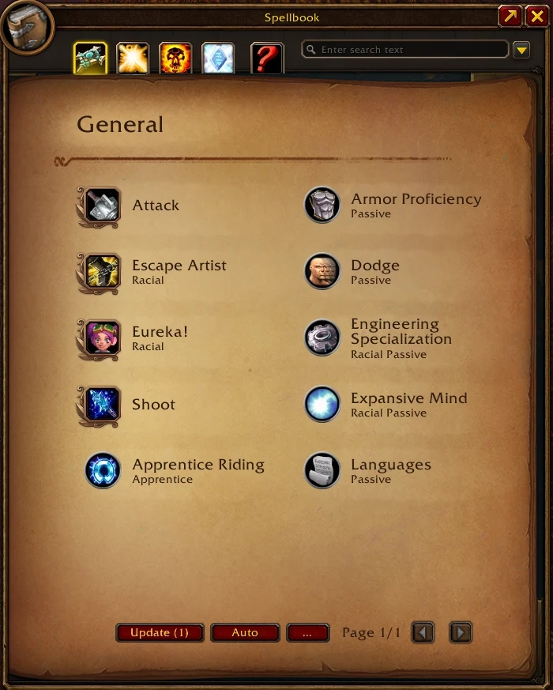
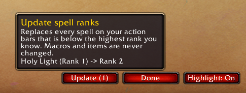
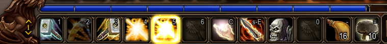
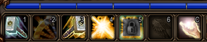

# MaxRank

Keeps your action bars on the highest spell rank you know, for **World of Warcraft: Forever** (Interface 16001).

On Forever, learning a new rank does not change the buttons that still hold the old one. MaxRank upgrades them in one click, lets you keep the ranks you want (downranking), and shows what is outdated.



The three buttons sit in the spellbook footer, left of the page arrows.

## Features

### Update

Replaces every spell on your action bars that is below the highest rank you know. It covers every bar and page, including stance and form pages you are not in. Macros, items and empty slots are never touched, and a spell is never downgraded.

The button shows how many slots it will change (it is greyed out when there is nothing to do), and its tooltip lists them:



### Highlight

Outdated buttons light up with a golden burst, then marching ants and a breathing glow, like a proc:



### Ignore

Click Ignore, then click a spell on your action bars, for example Holy Light (Rank 1). That exact rank is kept on every bar, while the other ranks of the spell are still upgraded. Click it again to stop ignoring it. The list is saved per character.

While Highlight or ignore mode is on, ignored ranks are greyed out with a padlock and a blue border:



## Commands

| Command | Effect |
|---|---|
| `/maxrank update` | upgrade outdated spells on your action bars |
| `/maxrank scan` | list outdated spells without changing anything |
| `/maxrank ignore` | toggle ignore mode |
| `/maxrank highlight` | toggle the glow on outdated spells |
| `/maxrank list` | list ignored ranks |
| `/maxrank clear` | stop ignoring every rank |
| `/maxrank bar on\|off` | show or hide the spellbook buttons |
| `/maxrank status` | version, saved data and spellbook details |

## Notes

- Action bars can only change out of combat. An update requested in combat runs when combat ends, and ignore mode closes when combat starts.
- In ignore mode, only mouse clicks are intercepted: key bindings still cast normally.
- Closing the spellbook turns Highlight off and ends ignore mode. Esc does both, since it closes the spellbook.
- Most Warrior and Rogue abilities (and some Druid and Paladin ones) replace their previous rank on their own, so there is usually nothing to update for them.
- Don't use it together with Auto Spell Ranks: that addon would upgrade the ranks you ignore.
- Only Blizzard's action bars get the glow and ignore mode. The update itself works on every action slot, whatever bar addon displays it.
- If ignored ranks are lost after a restart, check `/maxrank status`: the session counter must go up and saved data must say "loaded from disk".

## Development

Offline tests run the Lua files against a stubbed WoW API with Python and [lupa](https://pypi.org/project/lupa/):

```
python -m unittest discover -s tests -v
```
