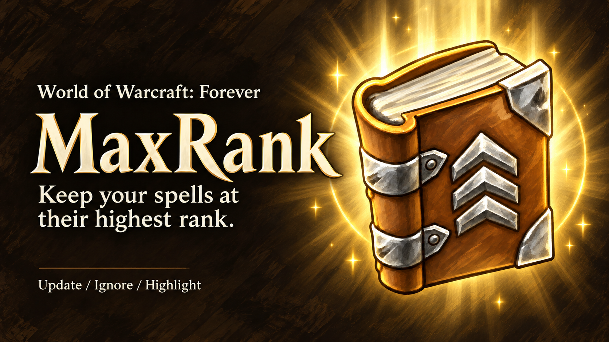
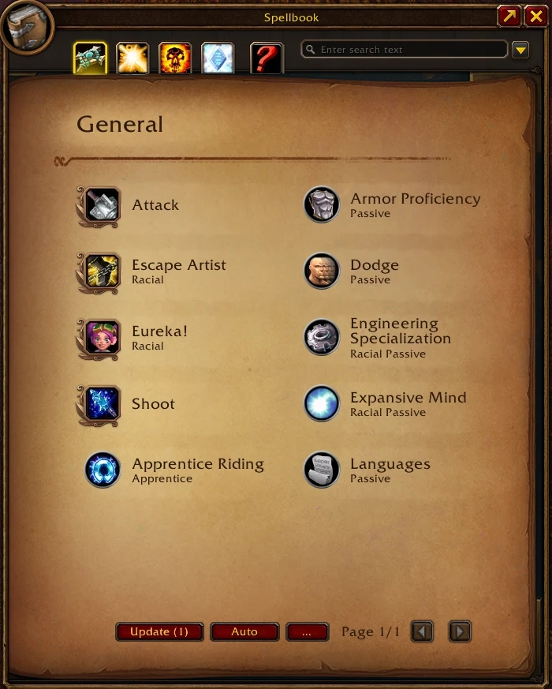
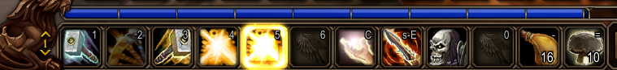
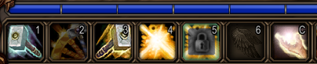
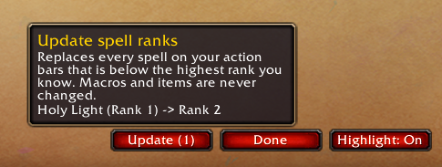

# MaxRank

**Keep every spell on your action bars at its highest rank, in one click. Built for World of Warcraft: Forever.**

In Forever, learning a new rank at your trainer doesn't change your action bars: your buttons keep casting the old rank until you drag the new one onto every bar yourself. MaxRank does it for you, lets you keep the low ranks you use on purpose (downranking), and shows at a glance what still needs an upgrade.

## Features

- **Update**: replaces every outdated spell on your action bars with the highest rank you know. Every bar and every page, including stance and form bars you aren't in right now.
- **Ignore**: keep a specific rank on purpose, like *Flash Heal (Rank 1)* for cheap heals. Ignored ranks are never touched, on any bar.
- **Highlight**: outdated spells glow gold on your bars, ignored ones show a padlock.
- **Safe**: never downgrades a spell, never touches macros or items, never changes your bars in combat.
- **Simple**: three buttons in your spellbook, nothing to set up.

## How to use

### 1. Open your spellbook

Press **P**. The three MaxRank buttons sit at the bottom of the spellbook, next to the page arrows: **Update**, **Ignore** and **Highlight**.

### 2. See what's outdated: Highlight

Click **Highlight**. Every spell on your bars that isn't at its highest rank lights up in gold.

Click it again, or close your spellbook, to turn it off.

### 3. Keep the ranks you want: Ignore

Using a low rank on purpose? Protect it before you update:

1. Click **Ignore**.
2. Click the spell on your action bar. It turns grey with a padlock: that exact rank is now kept on all your bars.
3. Changed your mind? Click it again to un-ignore it.
4. Right-click, press **Esc** or close your spellbook when you're done.

No risk of casting by mistake: while Ignore mode is on, clicking a button never casts the spell.

### 4. Upgrade everything else: Update

The **Update** button shows how many buttons it will change, for example *Update (3)*. Hover over it to see the list, then click it.

Each change is printed in your chat, like *Holy Light (Rank 1) -> Rank 2*. When everything is up to date, the button greys out.

**Tip:** after each visit to your class trainer, open your spellbook and click **Update**.

## Slash commands

Everything also works from the chat:

- `/maxrank update`: upgrade your bars now
- `/maxrank scan`: list outdated spells without changing anything
- `/maxrank ignore`: turn Ignore mode on or off
- `/maxrank highlight`: turn Highlight on or off
- `/maxrank list`: list your ignored ranks
- `/maxrank clear`: un-ignore every rank
- `/maxrank bar on` or `/maxrank bar off`: show or hide the spellbook buttons
- `/maxrank status`: version and diagnostic info

## Good to know

- **Combat:** action bars can't be changed in combat. Click Update during a fight and MaxRank updates your bars as soon as combat ends. Ignore mode turns off when combat starts.
- **Key bindings** still cast normally in Ignore mode: only mouse clicks are caught.
- **Ignored ranks are saved per character.**
- **Macros are never changed:** a macro like `/cast Flash Heal` already casts your highest rank.
- **Warriors and Rogues:** most of their abilities replace the previous rank on their own, so there's usually nothing to update.
- **Bar addons:** Update works with any bar addon. The glow and Ignore mode work on Blizzard's default action bars.
- Don't use MaxRank together with an addon that upgrades ranks automatically: it would undo your ignored ranks.

## Feedback

Found a bug or have an idea? Open an issue on [GitHub](https://github.com/jBeyondstars/MaxRank).
